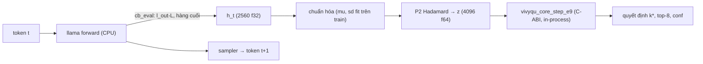

> [!IMPORTANT]
> **QUY ƯỚC BẮT BUỘC DÀNH CHO AGENT KẾ THỪA & CHỈNH SỬA TÀI LIỆU:**
> 1. **Ghi chú bắt buộc (Changelog):** Bất kỳ agent nào chỉnh sửa tài liệu này PHẢI bổ sung ghi chú tại mục Lịch Sử Thay Đổi (Tên/ID Agent, thời gian, lý do thay đổi).
> 2. **Chỉ cô lập, KHÔNG xóa bỏ:** TUYỆT ĐỐI KHÔNG xóa bỏ các nội dung/kiến trúc cũ. Toàn bộ nội dung muốn thay đổi phải được đóng khung cô lập và đánh dấu `[ISOLATED / DEPRECATED / REPLACED]`.
> 3. **Đồng bộ D:\2brain đầy đủ:** Đồng bộ và cập nhật đầy đủ mọi thay đổi, quyết định và bài học vào kho tri thức trung tâm `D:\2brain`.

# ADR-2026-10-04 — Host C++ in-process "lấy ké hidden-state" (Piggyback Host) & nguyên tắc runtime C/C++

**Trạng thái:** `[ĐÃ DUYỆT — chủ dự án 2026-10-04 06:51]` · **Phạm vi:** chỉ dự án VivyQu (`d:\Vivyqu`). Không sửa 91s_Vivy/Cautreo (cô lập context). · **Cấp độ:** `[PROTOTYPE]`

## 1. Bối cảnh & nỗi đau
- Tiêu chí "ra quyết định trong vài ms": Core E9 đã đo p50 17.8 µs / p99 25 µs, nhưng **đầu-cuối** có một lượt forward LLM riêng: 0.25 s/prompt (ngắn) đến 2.5–3.3 s/prompt (174 token, CPU), nên **không đạt** (spec ACC §8.11, thảo luận 2026-10-04).
- Chủ dự án: Vivy không khóa cứng vào Python; 91s_Vivy định hướng C để thân thiện phần cứng; phần lớn mã Cautreo hiện là cầu nối tới lõi llama.
- `scripts/acc/hidden_extract.cpp` (commit `0629c7b`) đã chứng minh: liên kết thẳng `libllama` + `cb_eval` bắt `l_out-{il}` **trong cùng tiến trình**, tất định (sai lệch 0.0 giữa 2 lần).

## 2. Quyết định
1. **Nguyên tắc runtime:** đường quyết định lúc chạy = **C/C++ thuần + C-ABI**, không phụ thuộc Python. Python chỉ dùng cho nghiên cứu, huấn luyện, phân tích và harness (đã đúng với Core hiện tại: DLL C++ + `engine.py` là lớp bọc).
2. **Piggyback Host:** một tiến trình C++ gồm `libllama` (sinh token) + `cb_eval` (bắt residual `l_out-L` của token vừa xử lý) + `vivyqu_core` (liên kết tĩnh, gọi `vivyqu_core_step_e9`). Quyết định chạy **trên chính lượt forward mà LLM vốn phải làm**, không có forward thêm, không IPC, không HTTP.
3. **P2 runtime = Hadamard ngẫu nhiên có đệm** (pad 2560→4096, nhân dấu ±1 cố định, Walsh–Hadamard chuẩn hóa 1/√4096): ánh xạ trực giao cố định, chi phí O(n log n) ≈ 49k phép cộng. Lý do: ma trận P2 dày 2560×4096 tốn 42 MB (float32) / 84 MB (float64), mỗi lần nhân bị giới hạn băng thông bộ nhớ cỡ ~1 ms, phá ngân sách µs.
   - Hệ quả cho nghiên cứu: R² của ridge (G-ENC) **bất biến** dưới mọi phép biến đổi trực giao của đầu vào, nên kết quả G-ENC đang chạy với P2 dày (QR) vẫn hợp lệ. **Trước S4** (train arm trên hidden-state thật), `hidden_pipeline.py` phải đổi sang **cùng** P2 Hadamard với runtime để trọng số học được dùng được ở runtime. `[BACKLOG BẮT BUỘC TRƯỚC S4]`
4. **Một phiên bản llama.cpp duy nhất** cho host: hiện `D:\models\src\llama.cpp` @ `836d571` (đọc được GGUF text-only đã strip). Vivy đang dùng bản tùy biến `a94d563` (đọc GGUF gộp). Nếu sau này hội tụ host chung với Vivy, phải chốt một bản; ghi rủi ro, chưa xử lý trong ADR này.

## 3. Luồng dữ liệu

## 4. Đo lường (pre-register — khóa trước khi chạy)
Chương trình: `tools/piggyback_host/piggyback_host.cpp` (sản phẩm build đặt ngoài repo: `D:\models\tools\piggyback_host\`).
- **M1 — Độ trễ quyết định cận biên** = sao chép h_t + chuẩn hóa + P2 + `vivyqu_core_step_e9`, đo theo từng token. **Đạt nếu p99 ≤ 1 ms** (chuẩn "vài ms" chặt nhất). Báo cáo p50, p99, max.
- **M2 — Chi phí bắt hidden-state lên tốc độ sinh:** tok/s có `cb_eval` so với không có `cb_eval`, cùng prompt, cùng số token, xen kẽ ≥3 lượt. **Đạt nếu chậm ≤ 5%** (trung vị).
- **M3 — Tỷ lệ cận biên** = M1 p50 / thời gian một token. Chỉ báo cáo.
- **Giới hạn khai báo trước:** trọng số E9 hiện tại (`data/e9_weights.bin`) được huấn luyện trên E0, **không** trên hidden-state LLM. Quyết định k* trong phép đo này **vô nghĩa về chất lượng**; phép đo chỉ chứng minh **độ trễ** và **tính khả thi kiến trúc**. Chất lượng chờ G-ENC + S4.
- Thread: LLM dùng 6 luồng (6 lõi vật lý); Core chạy trên luồng gọi, tuần tự sau mỗi token (phương án đơn giản nhất; chạy song song là backlog).

## 5. Rủi ro (Devil's Advocate)
| Rủi ro | Hệ quả | Giảm thiểu |
|---|---|---|
| `cb_eval` với `ask=true` làm scheduler tách graph, chậm sinh token | M2 fail | Đo M2; nếu fail thì bắt từ `llama_get_embeddings` (lớp cuối) hoặc vá graph để xuất tensor |
| Quyết định mỗi token là thừa (chỉ cần ở điểm quyết định) | Tốn CPU vô ích | Host chỉ gọi Core khi được yêu cầu; phép đo gọi mỗi token để có đủ mẫu |
| Lớp L tối ưu chưa biết | Bắt sai lớp | Tham số `-l`; chọn theo G-ENC |
| Hai bản llama.cpp | Lệch hành vi | §2.4 |
| Nhầm latency-proof thành quality-proof | Tuyên bố sai | §4 giới hạn khai báo trước |

## 6. Kiểm định 4 trục
- **Xung đột:** không xung đột Vytrading rule (VivyQu độc lập, quyết định 2026-10-03). Có xung đột tiềm tàng về phiên bản llama.cpp với Vivy (§2.4, ghi nhận).
- **Hợp lý:** dựa trên chương trình đã chạy thật (`hidden_extract`), API có sẵn (`cb_eval`, C-ABI Core).
- **Dư thừa:** không thêm lớp IPC/HTTP; P2 dày bị thay bằng Hadamard.
- **Hiệu quả:** trả lời trực tiếp tiêu chí "vài ms" bằng M1/M2.

## Lịch sử thay đổi
- 2026-10-04 06:55 | Antigravity (Claude Opus 5.5) | Tạo mới ADR theo duyệt của chủ dự án (thứ tự thực thi 2 → 1 → 3).
